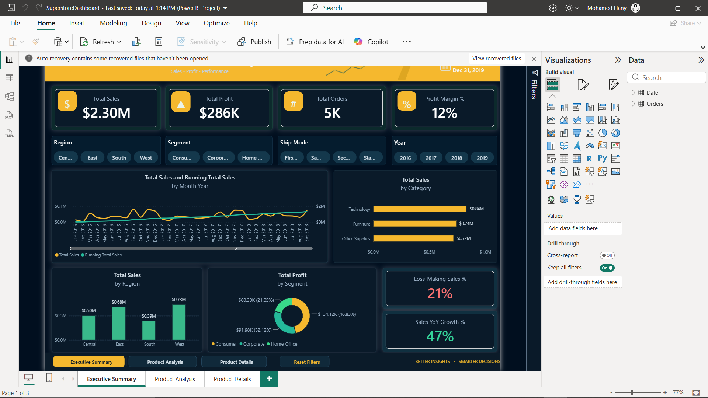
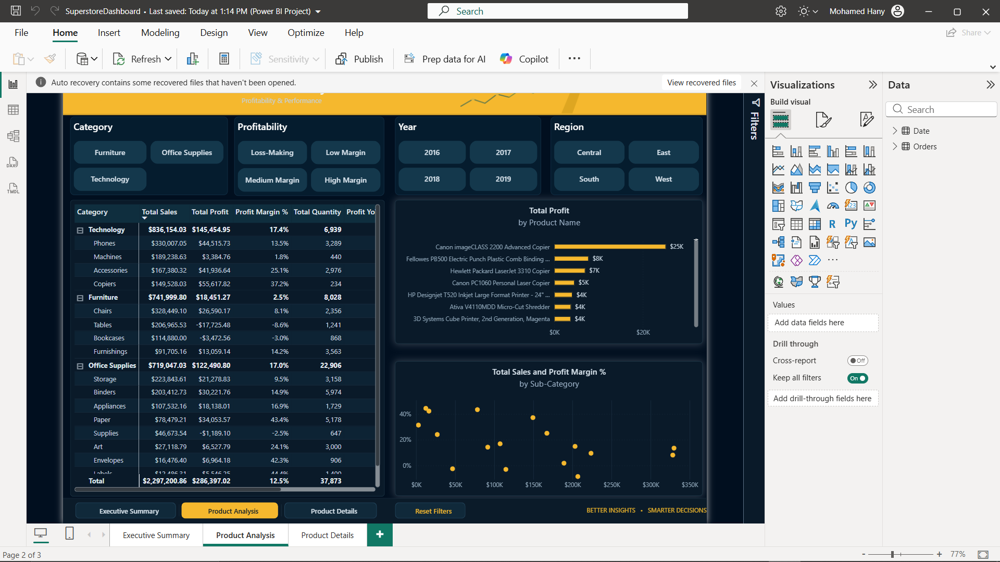
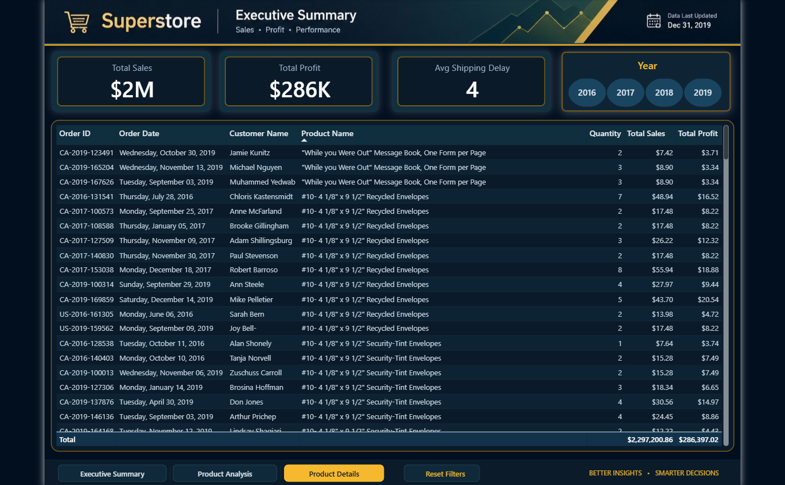
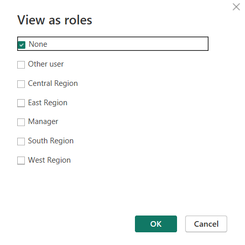

# 📊 Superstore Power BI Dashboard



**An end-to-end Business Intelligence solution that turns four years of retail transaction data into
an interactive, executive-ready analytics product — built entirely in Microsoft Power BI.**

<p>
  
  
  
  
  
</p>

---

## 📑 Table of Contents

- [Business Scenario](#-business-scenario)
- [Solution Workflow](#-solution-workflow)
- [Tech Stack](#-tech-stack)
- [Dataset](#-dataset)
- [Data Model](#-data-model)
- [DAX Measures](#-dax-measures-16)
- [Calculated Columns](#-calculated-columns-3)
- [Report Pages](#-report-pages)
- [Row-Level Security](#-row-level-security-rls)
- [Key Insights](#-key-insights)
- [Repository Structure](#-repository-structure)
- [Getting Started](#-getting-started)
- [Author](#-author)

---

## 🎯 Business Scenario

The retail company relies on the **Sample Superstore** transactional dataset but has no single source
of truth for performance reporting. Analysts spend hours rebuilding manual spreadsheet reports every
month, with no consistency, no time-intelligence, and no way to control who sees which region's data.

**The objective of this project is to replace that manual process with an automated, governed BI
solution that:**

1. Ingests and cleans raw transactional data automatically.
2. Models it into a proper star schema ready for time intelligence.
3. Surfaces performance trends and problem areas through DAX-driven KPIs.
4. Delivers an interactive, self-service experience across three report pages.
5. Protects data by region using **Row-Level Security**.

---

## 🧭 Solution Workflow

```
        ┌─────────────┐     ┌──────────────┐     ┌──────────────┐     ┌──────────────┐     ┌──────────────┐
        │  Raw Data   │ ──▶ │ Power Query  │ ──▶ │  Data Model  │ ──▶ │     DAX      │ ──▶ │    Report    │
        │  (Excel)    │     │    (ETL)     │     │  Star Schema │     │   Measures   │     │  + Security  │
        └─────────────┘     └──────────────┘     └──────────────┘     └──────────────┘     └──────────────┘
         transactions         extract /           Orders + Date       16 measures /        3 pages /
                              clean / type        relationship        3 calc columns       5 RLS roles
```

| Stage | Tool | What was done |
|:------|:-----|:--------------|
| **1. Ingest** | Power Query | Connected to the source workbook and loaded raw orders |
| **2. Clean** | Power Query | Corrected data types, trimmed text, removed invalid/null rows |
| **3. Model** | Power BI | Built a star schema (fact + date dimension) with a date relationship |
| **4. Analyze** | DAX | Added 16 measures and 3 calculated columns for KPIs & time intelligence |
| **5. Visualize** | Power BI | Designed 3 interactive report pages with 9 slicers and drill-through |
| **6. Secure** | RLS | Configured 5 roles for region-based access control |

---

## 🛠️ Tech Stack

| Tool | Role in this project |
|:-----|:---------------------|
| **Microsoft Power BI Desktop** | Data model, DAX, and report design |
| **Power Query (M)** | Data extraction and transformation |
| **DAX** | Measures, calculated columns, time intelligence |
| **Microsoft Excel** | Source dataset |

---

## 🗂️ Dataset

The **Sample Superstore** retail dataset — 4 years of orders (2016 → 2019).

| Property | Value |
|:---------|:------|
| Rows | **9,994** order lines |
| Date range | 2016-01-03 → 2019-12-30 |
| Total Sales | **$2,297,200.86** |
| Total Profit | **$286,397.02** |
| Key dimensions | Category, Sub-Category, Region, State, City, Segment, Ship Mode |
| Key measures | Sales, Quantity, Discount, Profit |

---

## 📐 Data Model

A clean **star schema** with a dedicated date dimension for time intelligence:

```
        ┌────────────────────────┐            ┌───────────────────────┐
        │          Date          │            │        Orders         │
        ├────────────────────────┤            ├───────────────────────┤
        │ Date          (PK)     │◀──────────│ Order Date     (FK)   │
        │ Year                   │   1 : M    │ Ship Date             │
        │ Month                  │            │ Sales / Profit / Qty  │
        │ Month Year             │            │ Discount              │
        │ MonthYearSort          │            │ Region / State / City │
        └────────────────────────┘            │ Category / Sub-Cat    │
                                              │ Shipping Delay        │
                                              │ Profitability Cat.    │
                                              └───────────────────────┘
```

- **Active relationship:** `Orders[Order Date]` → `Date[Date]` (many-to-one, single filter direction)
- **Date table:** a complete, gap-free calendar of **1,461 days** with a Year → Month hierarchy
- The relationships enable every time-intelligence function used in the measures below.

---

## 🧮 DAX Measures (16)

All measures live on the `Orders` table.

| # | Measure | Purpose |
|:-:|:--------|:--------|
| 1 | `Total Sales` | Core revenue KPI |
| 2 | `Total Profit` | Core profitability KPI |
| 3 | `Total Quantity` | Units sold |
| 4 | `Total Orders` | Distinct order count |
| 5 | `Profit Margin %` | Profit as a share of sales |
| 6 | `Average Discount` | Average discount applied |
| 7 | `Avg Shipping Delay` | Fulfilment speed |
| 8 | `Loss-Making Sales %` | Share of revenue from unprofitable orders |
| 9 | `Loss-Making Orders %` | Share of orders that lose money |
| 10 | `Sales Previous Year` | Sales, prior-year comparable period |
| 11 | `Sales YoY Growth %` | Sales year-over-year growth |
| 12 | `Profit Previous Year` | Profit, prior-year comparable period |
| 13 | `Profit YoY Growth %` | Profit year-over-year growth |
| 14 | `Running Total Sales` | Cumulative sales over time |
| 15 | `Average Order Value` | Revenue per order |
| 16 | `Average Order Profit` | Profit per order |

<details>
<summary><b>📄 View full DAX expressions</b></summary>

<br>

**Core KPIs**
```dax
Total Sales       = SUM ( Orders[Sales] )
Total Profit      = SUM ( Orders[Profit] )
Total Quantity    = SUM ( Orders[Quantity] )
Total Orders      = DISTINCTCOUNT ( Orders[Order ID] )
Profit Margin %   = DIVIDE ( [Total Profit], [Total Sales] )
Average Discount  = AVERAGE ( Orders[Discount] )
Avg Shipping Delay = AVERAGE ( Orders[Shipping Delay] )
Average Order Value  = DIVIDE ( [Total Sales], [Total Orders] )
Average Order Profit = DIVIDE ( [Total Profit], [Total Orders] )
```

**Loss-making analysis**
```dax
Loss-Making Sales % =
VAR _LossMakingSales =
    CALCULATE (
        [Total Sales],
        FILTER ( VALUES ( Orders[Order ID] ), CALCULATE ( [Total Profit] ) < 0 )
    )
RETURN
    DIVIDE ( _LossMakingSales, [Total Sales] )

Loss-Making Orders % =
VAR _LossMakingOrders =
    COUNTROWS ( FILTER ( VALUES ( Orders[Order ID] ), CALCULATE ( [Total Profit] ) < 0 ) )
RETURN
    DIVIDE ( _LossMakingOrders, [Total Orders] )
```

**Time intelligence**
```dax
Sales Previous Year  = CALCULATE ( [Total Sales], SAMEPERIODLASTYEAR ( 'Date'[Date] ) )
Profit Previous Year = CALCULATE ( [Total Profit], SAMEPERIODLASTYEAR ( 'Date'[Date] ) )

Sales YoY Growth % =
VAR _MaxYear = MAX ( 'Date'[Year] )
VAR _CurrentYearSales = CALCULATE ( [Total Sales], 'Date'[Year] = _MaxYear )
VAR _PriorYearSales   = CALCULATE ( [Total Sales], 'Date'[Year] = _MaxYear - 1 )
RETURN
    IF ( NOT ISBLANK ( _PriorYearSales ),
         DIVIDE ( _CurrentYearSales - _PriorYearSales, _PriorYearSales ) )

Profit YoY Growth % =
VAR _MaxYear = MAX ( 'Date'[Year] )
VAR _CurrentYearProfit = CALCULATE ( [Total Profit], 'Date'[Year] = _MaxYear )
VAR _PriorYearProfit   = CALCULATE ( [Total Profit], 'Date'[Year] = _MaxYear - 1 )
RETURN
    IF ( NOT ISBLANK ( _PriorYearProfit ),
         DIVIDE ( _CurrentYearProfit - _PriorYearProfit, _PriorYearProfit ) )

Running Total Sales =
CALCULATE (
    [Total Sales],
    FILTER ( ALLSELECTED ( 'Date'[Date] ), 'Date'[Date] <= MAX ( 'Date'[Date] ) )
)
```

</details>

---

## ➕ Calculated Columns (3)

| Column | Logic |
|:-------|:------|
| `Shipping Delay` | Days between order and ship date — `DATEDIFF(order, ship, DAY)` |
| `Profitability Category` | Loss-Making / Low / Medium / High Margin bucket |
| `Profitability Order` | Numeric sort key for the category (1–4) |

```dax
Shipping Delay = DATEDIFF ( Orders[Order Date], Orders[Ship Date], DAY )

Profitability Category =
SWITCH (
    TRUE (),
    Orders[Profit] < 0, "Loss-Making",
    DIVIDE ( Orders[Profit], Orders[Sales] ) < 0.10, "Low Margin",
    DIVIDE ( Orders[Profit], Orders[Sales] ) < 0.20, "Medium Margin",
    "High Margin"
)
```

---

## 📈 Report Pages

### 1️⃣ Executive Summary
> *The "one-glance" health check of the business.*

KPI cards (Sales, Profit, Margin, Orders), sales & profit trends over time, and
year-over-year growth — with a **Region** slicer and a one-click reset.


### 2️⃣ Product Analysis
> *Where the money is made — and lost.*

Category and sub-category performance, profit-margin comparison, and a ranked product
analysis that exposes low-margin and loss-making lines.



### 3️⃣ Product Details (Drill-through)
> *The deep dive.*

A dedicated **drill-through** page reached from any product/category, showing the
order-level detail behind the numbers.



**Interactivity across the report:** 9 slicers (4 + 4 + 1), cross-filtering between
visuals, drill-through navigation, and a reset-filters action.

---

## 🔐 Row-Level Security (RLS)

Region-based access control with **5 roles**:

| Role | Filter |
|:-----|:-------|
| **Central Region** | `Orders[Region] = "Central"` |
| **East Region** | `Orders[Region] = "East"` |
| **South Region** | `Orders[Region] = "South"` |
| **West Region** | `Orders[Region] = "West"` |
| **Manager** | *(no filter — full visibility)* |

> ℹ️ Members are assigned **in the Power BI Service** after publishing
> (Dataset → *Security*), keeping the local `.pbix` free of personal accounts.

**What a user in a region role sees** — the report automatically filtered to their region only:



---

## 📌 Key Insights

| Insight | Value |
|:--------|:------|
| 2019 Sales | **$733K** — up **20.4%** YoY |
| 2019 Profit growth | **+14.2%** YoY |
| **Furniture** profit margin | only **~2%** |
| Technology / Office Supplies margin | **~17%** each |
| Loss-making order lines | **1,871** |
| Average shipping delay | **~4 days** |

**Takeaway:** revenue is growing healthily, but profitability is dragged down by the
**Furniture** category — a clear target for pricing, discount, and product-mix review.

---

## 📂 Repository Structure

```
Superstore-PowerBI-Dashboard/
├── SuperstoreDashboard.pbix        # Power BI report + data model (DAX, RLS)
├── Sample - Superstore 2019.xlsx   # Source dataset
├── screenshots/
│   ├── 01-executive-summary.png
│   ├── 02-product-analysis.png
│   ├── 03-product-details.png
│   └── 04-row-level-security.png
├── README.md
└── .gitignore
```

---

## 🚀 Getting Started

1. Install **[Power BI Desktop](https://powerbi.microsoft.com/desktop/)** (free).
2. Clone or download this repository:
   ```bash
   git clone https://github.com/Mohamed-Hany-Abdelfattah/Superstore-PowerBI-Dashboard.git
   ```
3. Open **`SuperstoreDashboard.pbix`**.
4. Explore the three report pages and interact with the slicers.

> **Note:** the data model is embedded, so the report opens standalone.
> To **refresh**, point the source to `Sample - Superstore 2019.xlsx`.

---

## 👤 Author

**Mohamed Hany Abdelfattah**

[](https://github.com/Mohamed-Hany-Abdelfattah)

---

<p align="center"><i>Built as part of the <b>Digital Egypt Pioneers Initiative (DEPI)</b> — Data Analytics track.</i></p>
